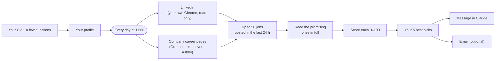

<p align="center">
  
</p>

<h3 align="center">Your job hunter. 5 jobs worth chasing, every morning at 11:00.</h3>

<p align="center">
  <a href="https://dub.sh/cazador"><strong>Get Cazador (free)</strong></a> ·
  <a href="docs/How-to-install-Cazador.pdf">Install guide (PDF)</a> ·
  <a href="skill/cazador/SKILL.md">Read the skill</a>
</p>

---

[**Cazador**](https://dub.sh/cazador) (Spanish for "hunter") is an AI agent that runs inside [Claude](https://claude.ai). Every morning it looks at the jobs posted in the last 24 hours in your target cities, reads the promising ones in full, and sends you the **5 best fits for your background**, each with why it fits, your way in, what to lead with, watch-outs and pay.

You set it up once with your CV, in about 5 minutes. After that it runs on its own.

## What a morning looks like

Each run sends one message in Claude (and, if you want, an email from your own Gmail or Outlook). The format:

```text
Cazador — <date>: <N> jobs looked at, your 5 best picks:

1. <Title> — <Company>  (<city>, posted <x> hours ago, <applicants>), fit <score>/100
   - Why you:     1–2 sentences tying the posting's asks to your background
   - Your way in: connections, school alumni or hiring team, if visible
   - Lead with:   the one hook for your application or referral ask
   - Watch-outs:  gaps, language or visa flags
   - Pay:         in your currency, or "Not listed"
   - Link:        the job's own URL

2. ...

One sentence on today's market across your cities.
```

If fewer than 5 jobs are genuinely good that day, it sends fewer. It never pads the list.

## How it works



1. **Setup.** You attach your CV and answer two short rounds of questions: target roles, up to 5 cities, seniority, where you can work without a visa, languages, hard no's, time zone and currency. Claude writes a short profile of you, and you correct it until it's right.
2. **Sources.** You choose LinkedIn, company career pages, or both.
   - **LinkedIn** is searched signed in as you, in your own Chrome, through the Claude in Chrome extension. It has the widest coverage and shows your connections and school alumni at each company.
   - **Career pages** are the public job boards (Greenhouse, Lever, Ashby) of about 80 companies picked for your roles and cities. No account involved, and it runs in the cloud even with your laptop closed.
3. **Daily run.** A scheduled task runs at 11:00 in your time zone. It collects up to 50 new jobs (at most 14 per city), reads every plausible one in full, and scores each one:

   | Criterion | Weight |
   |---|---|
   | Role match with your target roles | 35 |
   | Seniority match | 20 |
   | How much your differentiators matter for it | 20 |
   | Company quality and trajectory | 15 |
   | Practicality: language, work authorization, applicant count, a way in | 10 |

4. **Picks.** The top 5, best first, arrive as a message in Claude and, optionally, by email.

## Ground rules it follows

- **Read-only.** It never applies, saves, follows, connects, messages anyone, or changes anything on any site. It never enters passwords or verification codes.
- **No invented jobs.** Titles, companies and links come exactly from the source pages, never from memory. It never picks a job it hasn't read in full.
- **Honest about gaps.** If a source can't be reached, it says so in the message instead of guessing.
- **Nothing goes through me.** Your profile lives in your own Claude account, and the picks email is sent from your own account to your own address.

## Design decisions

- **A Claude skill, not an app.** Claude already does what this needs: reading CVs, browsing, reasoning about fit, scheduling and sending email. Packaging it as a skill means no servers, no accounts to create, and no personal data stored anywhere but the user's own Claude.
- **Two sources, with an honest trade-off.** LinkedIn gives the best coverage and shows who you know, but its terms don't allow automated browsing. Cazador keeps that low-risk (read-only, at a person's pace) and tells users plainly. Anyone who'd rather avoid the risk can choose career pages only, which use public job board APIs.
- **Once a day, at 11:00.** One focused run instead of constant alerts. Runs that need the computer are skipped if it's off rather than catching up later, and "run Cazador" gets the picks on demand.
- **Quality over quantity.** Five picks, each read in full and explained, instead of a long list of links. Fewer than five when the day is thin.
- **Cheap to run.** The guide recommends Sonnet, which searches and ranks well while using less of a plan's limits.
- **From paid to free.** Cazador started as a small paid add-on for MBA classmates. In November 2026 I made it free so more people could use it.

## Install

You need a **paid Claude plan** (Pro, Max, Team or Enterprise). For LinkedIn, you also need the Claude desktop app and Google Chrome with the Claude extension.

1. **Download** `cazador-agent.zip` from [dub.sh/cazador](https://dub.sh/cazador). Keep it zipped.
2. In Claude, open **Settings → Capabilities** and switch on **Code execution and file creation** (called **Create and edit files** in the newer layout).
3. Go to **Customize → Skills**, click **+**, then **Create skill → Upload a skill**, and choose the ZIP.
4. Start a new chat, attach your CV and type **Set up Cazador**.

The full step-by-step guide, with screenshots, is in [docs/How-to-install-Cazador.pdf](docs/How-to-install-Cazador.pdf).

**Building the ZIP yourself:** zip the `skill/cazador` folder so the archive contains a top-level `cazador/` folder with `SKILL.md` inside.

## Using it

Just talk to Claude, in any chat:

| You type | What happens |
|---|---|
| `Set up Cazador` | Setup: CV, questions, profile, first picks, daily 11:00 run |
| `run Cazador` | Runs it right now, e.g. after a missed 11:00 run |
| `Change my Cazador: add London` | Updates cities, roles, sources, companies or email |
| `Pause my Cazador` | Pauses the daily run |

## What's in this repo

```text
skill/cazador/
├── SKILL.md                       # setup, run now, change or stop
└── references/
    ├── daily-run.md               # the prompt each daily run follows
    └── profile-template.md        # the profile written from your CV
docs/How-to-install-Cazador.pdf    # install guide
assets/cazador-logo.png
```

## Roadmap

- A ChatGPT version.
- Ideas welcome: open an [issue](../../issues).

## About

Built by **Lupillo Andazola**, HEC Paris MBA, with Claude. More at [lupilloandazola.com](https://lupilloandazola.com).

Cazador is an independent project. It is not affiliated with or endorsed by Anthropic, LinkedIn, Greenhouse, Lever or Ashby.

Released under the [MIT License](LICENSE).
